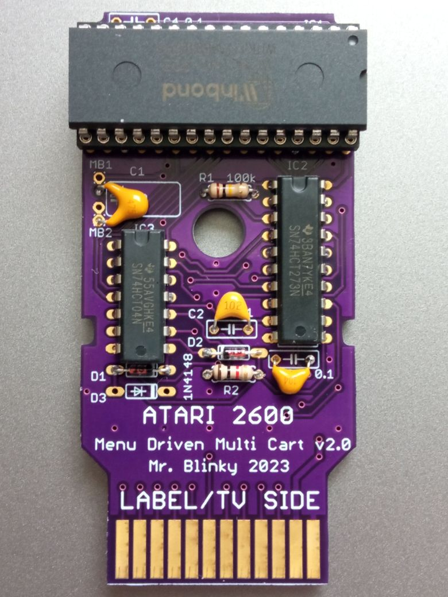

# MDMC - Menu Driven Multi Cart

A Menu driven Multi Cart for the Atari 2600 made out of a few descrete logic chips and a (E)EPROM or FLASH memory.

Boards can be ordered from [OSH Park](https://oshpark.com/shared_projects/qgWffwwL) or you can create your own using the Eagle board file.

The original project for this started a long time ago. You can check it out on [AtariAge](https://forums.atariage.com/topic/56073-cheap-2k4k-x-in-1-menu-driven-multicart-for-atari-2600/)
